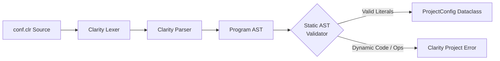

# Clarity 0.6 Architecture & Specification: Projects & Modules

**Milestone:** Clarity 0.6.x  
**Status:** Authoritative Design & Specification (Design Review Completed)  
**Author:** Antigravity AI & Creebrine  
**Target Date:** Post-0.5.0 Distribution  

---

## 1. Executive Summary

Clarity 0.5.0 established a robust standalone scripting language with a 199-test verified runtime, globally accessible standard library built-ins, standalone runtime packaging, and native Windows installer architecture.

Clarity 0.6 elevates Clarity from a single-file scripting tool to a **cohesive, multi-file project and modular programming language**. It introduces:
1. **Static Project Manifest (`conf.clr`)**: A native, declarative Clarity configuration format extracted purely at the AST level for total safety.
2. **First-Class Module & Import System (`from "..." import ...` and `import "..." as ...`)**: Explicit, isolated, and cached module resolution using quoted string paths.
3. **Unified Dot Access (`target.member`)**: Seamless member access across module namespaces and dictionary properties.
4. **Enhanced Project CLI (`clarity run`, `clarity new`, `clarity test`)**: Deterministic upward project discovery and standard project scaffolding.
5. **Hybrid Native Test Runner**: Automated discovery and execution of `test_*` functions across project test suites.
6. **Zero-Breakage Backward Compatibility**: 100% preservation of single-file script execution (`clarity script.clr`).

---

## 2. Goals & Non-Goals

### Goals
* **Clarity-Native Philosophy**: Configuration, imports, and member access must read like structured English without unnecessary ceremony: *"Code that speaks for itself"*.
* **Zero Configuration for Small Scripts**: Running single `.clr` files or ad-hoc scripts requires zero manifests, directories, or boilerplate.
* **Deterministic Module Resolution**: Absolute clarity on where modules are loaded from, how cycles are prevented, and how cached environments behave.
* **Total Configuration Safety**: `conf.clr` is statically analyzed at the AST level—never dynamically executed with arbitrary side effects.
* **Clean Scaffolding & Testing**: First-class developer ergonomics with `clarity new` and `clarity test`.
* **Future Package-Manager Ready**: Seamlessly leaves room for future third-party dependencies (0.7+) without breaking local project semantics.

### Non-Goals (Explicitly Deferred)
* **`clarity build` / AOT Compilation**: Clarity 0.6 remains an interpreted language. A dummy `build` command that merely copies files is rejected. Bytecode caching and native compilation will be addressed in a future milestone.
* **Online Package Manager (`clarity install` / `clarity add`)**: Networked registries and package lockfiles are deferred to 0.7+. 0.6 strictly addresses local file and directory modules.
* **Dotted Module Identifiers (`import foo.bar`)**: Deferred to 0.7+; 0.6 strictly uses quoted file paths (`import "foo/bar" as bar`) for total filesystem clarity and portability.
* **Complex Object-Oriented Class Systems**: Modules are namespaces for functions, constants, and data structures; they are not classes or inheritance hierarchies.
* **Source Code Formatter (`clarity fmt`)**: Scoped to a separate toolchain milestone.
* **Language Server Protocol (LSP)**: Scoped to the editor tooling milestone.

---

## 3. Proposed Project Structure

Clarity projects scale gracefully from single files to large multi-module applications without imposing rigid ceremony on small tasks.

### 3.1 Tier 1: Single Script (Zero-Config)
For one-off automation and quick scripts, no directory structure or manifest is needed:
```text
my-script/
└── script.clr
```
*Execution:* `clarity script.clr`

---

### 3.2 Tier 2: Minimal Project
For small applications with configuration or multiple files:
```text
hello-world/
├── conf.clr
└── main.clr
```
*Execution:* `clarity run` (from anywhere inside `hello-world/`)

---

### 3.3 Tier 3: Standard Multi-Module Project
The canonical layout for production applications and libraries:
```text
my-app/
├── conf.clr
├── README.md
├── src/
│   ├── main.clr
│   ├── users.clr
│   └── utils/
│       ├── formatting.clr
│       └── math_helpers.clr
└── tests/
    ├── main_test.clr
    └── users_test.clr
```

#### Directory Roles:
* **`conf.clr`**: The root manifest defining project identity, version, entry point, and metadata.
* **`src/`**: Primary application source code. All root-relative imports resolve against `src/` (or project root if `src/` is omitted).
* **`tests/`**: Native test suite files discovered by `clarity test` (`*_test.clr` or `test_*.clr`).
* **`README.md`**: Standard project documentation.

---

## 4. Project Configuration (`conf.clr`)

### 4.1 Safety Architecture: Static AST Extraction (Zero Dynamic Execution)

To guarantee that project discovery and tooling inspection are **100% safe, side-effect-free, and instantaneous**, `conf.clr` is **never executed with the dynamic runtime evaluator**.

Instead, the toolchain parses `conf.clr` using the standard Clarity `Lexer` and `Parser` and extracts configuration values directly from the AST (`DictionaryNode` containing literal values).



### 4.2 Canonical `conf.clr` Format

```clr
# Clarity Project Configuration
set project to {
    name: "my-app",
    version: "0.1.0",
    entry: "src/main.clr",
    description: "A high-performance CLI utility written in Clarity",
    author: "Creebrine <team@creebrine.com>",
    license: "MIT"
}
```

### 4.3 Validation & Semantic Rules

1. **Top-Level Form**: Must consist strictly of comments and a single assignment: `set project to { ... }`.
2. **Value Restriction**: All values within the `project` dictionary must be static literals (`string`, `number`, `boolean`, `nothing`, or lists/dictionaries of literals).
3. **Disallowed Constructs**: Function calls, binary operators, loops, control flow, and I/O statements are strictly forbidden and produce a compile-time diagnostic.
4. **Required Fields**:
   - `name`: Non-empty string matching `^[a-zA-Z0-9_-]+$`.
   - `version`: Valid SemVer string (e.g. `"0.1.0"`).
5. **Optional Standard Fields**:
   - `entry`: Relative path string (defaults to `"src/main.clr"` if `src/` exists, else `"main.clr"`).
   - `description`: String summary.
   - `author`: Author identity string.
   - `license`: SPDX identifier string.
   - `dependencies`: Dictionary of string key-values (reserved for 0.7+ package management).
6. **Unknown Fields**: Allowed as user metadata, but ignored by core tooling.

---

## 5. Module & Import System

### 5.1 Syntax Design

Clarity 0.6 introduces two explicit, English-inspired import forms using **quoted string paths**:

#### 1. Named Selective Import (`from "..." import ...`)
Imports specific functions or variables directly into the local scope:
```clr
from "utils/formatting" import format_name, capitalize
from "math_helpers" import calculate_total

set output to format_name("creebrine")
say output
```

*Natural Chaining:* In addition to commas, items can be separated with Clarity's natural `and` keyword:
```clr
from "utils/formatting" import format_name and capitalize
```

#### 2. Whole Module Import (`import "..." as ...`)
Imports an entire module into an explicit namespace alias:
```clr
import "utils/formatting" as fmt
import "math_helpers" as math

say fmt.format_name("alice")
say math.calculate_total(10, 20)
```

*Note on Bare Imports:* To eliminate ambiguity regarding implicit identifier names (e.g. what identifier would `import "utils/string-helpers"` bind?), whole-module imports **must specify an explicit alias using `as <identifier>`**.

### 5.2 Grammar Additions

```ebnf
import_statement    ::= "import" STRING "as" IDENTIFIER
                      | "from" STRING "import" import_item_list

import_item_list    ::= import_item ( ( "," | "and" ) import_item )*
import_item         ::= IDENTIFIER [ "as" IDENTIFIER ]
```

### 5.3 Module Resolution Rules

When resolving `from "path/specifier" import ...` or `import "path/specifier" as ...`:

1. **Relative Paths** (Starts with `./` or `../`):
   - Resolved relative to the directory of the file containing the import statement.
2. **Project-Root Paths** (e.g. `"utils/formatting"`):
   - Search 1: `<project_root>/src/<specifier>.clr` (if `src/` directory exists).
   - Search 2: `<project_root>/<specifier>.clr`.
   - Search 3: Directory module fallback `<specifier>/main.clr` or `<specifier>/mod.clr`.
   - Search 4: In standalone script mode (no `conf.clr`), search relative to the script's directory.
3. **Resolution Failure**: Halts execution and emits a clear diagnostic listing all checked filesystem locations.

### 5.4 Module Isolation, Caching & Encapsulation
* **Independent Execution Scope**: Each module executes in its own top-level `Environment` with access to global standard library built-ins.
* **Singleton Evaluation (Module Cache)**: A module is evaluated only **once** per runtime process. Subsequent imports reuse the cached exported environment.
* **Encapsulation Convention**:
  - All top-level function declarations and `set` variables are **publicly exported by default**.
  - Identifiers beginning with an underscore (`_private_helper`, `_INTERNAL_STATE`) are **module-private**. Attempting to import an underscore-prefixed name raises a `Clarity Import Error`.

### 5.5 Circular Dependency Prevention
A loading stack monitors in-flight module evaluations:
* If Module A imports Module B, and Module B directly or indirectly imports Module A while Module A is still initializing, the runtime halts immediately with a clear cycle graph:
  ```text
  Clarity Circular Import Error

  Detected circular dependency cycle:
    1. src/main.clr imports "services/user"
    2. src/services/user.clr imports "services/auth"
    3. src/services/auth.clr imports "services/user"

  Line 2, column 1 in src/services/auth.clr
  ```

---

## 6. Unified Dot Operator (`target.member`)

### 6.1 Unified Semantics

Clarity 0.6 introduces the **Dot Operator (`.`)** as a general, read-only property/member access operator with identical semantics across modules and dictionaries:

```clr
import "utils" as utils

set user to {
    name: "Creebrine",
    role: "Developer"
}

# Module member access:
say utils.greet("Alice")

# Dictionary property access:
say user.name   # Equivalent to user["name"]
```

### 6.2 Operational Rules

1. **Module Lookup**: If `target` is a `ClarityModule`, looks up `member` in the module's exported symbol table. If not found or private (`_`), raises `Clarity Runtime Error: Module '...' has no exported member '...'`.
2. **Dictionary Lookup**: If `target` is a `ClarityDict`, looks up `member` as a string key. If not present, raises `Clarity Runtime Error: Property '...' not found in dictionary`.
3. **Identifier Keys Only**: Dot access requires a valid identifier name (`user.name`). Non-identifier keys (e.g. keys containing spaces, numbers, or special symbols) continue to use index access (`data["first name"]`, `data[0]`).
4. **Mutation / Assignment**: In 0.6, dictionary mutation remains strictly via index assignment:
   ```clr
   set user["name"] to "Bob"
   ```
   *Rationale:* Keeps the assignment AST clean and avoids subtle ambiguity between variable re-assignment and object mutation.

---

## 7. Command-Line Interface (CLI) Design

The Clarity CLI provides a streamlined developer experience across script and project workflows.

```text
Usage: clarity [COMMAND] [OPTIONS] [FILE]

Commands:
  run [ENTRY]       Execute a Clarity project or specified entry file
  new <NAME>        Scaffold a new Clarity project with canonical layout
  test [PATH]       Discover and run project test suites
  help [COMMAND]    Display help information for Clarity or a command

Options:
  --version, -v     Print Clarity version
  --help, -h        Print help information
```

### 7.1 Detailed Command Specifications

#### 1. `clarity <file.clr>` (Script Mode)
* **Purpose**: Backward-compatible execution of standalone scripts.
* **Behavior**: Runs the file directly. Relative imports (`./helper`) resolve from the file's directory. No `conf.clr` required.
* **Exit Codes**: `0` on success, `1` on execution error, `2` on missing file.

#### 2. `clarity run [entry]` (Project Mode)
* **Purpose**: Run the current project.
* **Behavior**:
  1. Traverses parent directories to discover `conf.clr`.
  2. If `entry` is supplied (`clarity run src/app.clr`), executes that file.
  3. Otherwise, executes the configured `entry` in `conf.clr` (or default `src/main.clr` / `main.clr`).
* **Exit Codes**: `0` on success, `1` on execution error, `2` on manifest/project error.

#### 3. `clarity new <project_name>` (Project Scaffolding)
* **Purpose**: Generate a new canonical project structure.
* **Behavior**:
  - Creates `<project_name>/` containing `conf.clr`, `src/main.clr`, `tests/main_test.clr`, and `README.md`.
  - Rejects if the target directory already exists and is non-empty.
* **Exit Codes**: `0` on success, `1` on I/O error, `2` on invalid project name.

#### 4. `clarity test [path]` (Test Runner)
* **Purpose**: Execute native Clarity project test suites.
* **Behavior**: Discovers and runs all `*_test.clr` and `test_*.clr` files under `tests/` (or given `path`).
* **Exit Codes**: `0` if all tests pass, `1` if any test fails or errors.

---

## 8. Project Discovery Algorithm

```text
1. Start at Current Working Directory (CWD).
2. While CWD is not filesystem root:
   a. Check if 'conf.clr' exists in CWD.
   b. If found -> Set PROJECT_ROOT = CWD, stop search.
   c. If not found -> Move to parent directory: CWD = dirname(CWD).
3. If 'conf.clr' is found:
   - Operate in Project Mode.
4. If 'conf.clr' is NOT found:
   - For 'clarity run': If 'src/main.clr' or 'main.clr' exists in CWD, run in zero-config mode. Otherwise error:
     "Clarity Project Error: No conf.clr found in current or parent directories."
   - For 'clarity test': Run tests found in './tests/' if directory exists.
```

---

## 9. Native Testing Model (`clarity test`)

### 9.1 Test Execution Architecture (Model D: Hybrid Model)

Clarity 0.6 uses a **Hybrid Execution Model** that balances simplicity with granular reporting:

```mermaid
flowchart TD
    Start[Discover Test Files] --> LoadFile[Load and Parse Test File]
    LoadFile --> ExecTopLevel[Execute Top-Level Statements & Imports]
    ExecTopLevel --> CheckFuncs{Contains Functions<br/>Starting with 'test_'?}
    
    CheckFuncs -- Yes --> RunEach[Execute Each 'test_*()' Function Independently]
    RunEach --> CollectFunc[Record Pass/Fail per Function]
    
    CheckFuncs -- No --> TopLevelPass[Top-Level Execution Counts as 1 Test]
    TopLevelPass --> CollectScript[Record Pass/Fail for Script]
    
    CollectFunc --> NextFile{More Test<br/>Files?}
    CollectScript --> NextFile
    NextFile -- Yes --> LoadFile
    NextFile -- No --> Summary[Render Formatted Test Summary Table]
```

### 9.2 Assertion Built-ins (Standard Library)
Zero new compiler keywords are introduced. Assertions are native standard library built-ins available in all execution contexts:
* `assert(condition, message)`: Raises `Clarity RuntimeError` if `condition` is falsey.
* `assert_equal(actual, expected, message)`: Compares `actual == expected`. If false, raises `Clarity RuntimeError` with formatted actual vs. expected values.

### 9.3 Test Example (`tests/math_test.clr`)

```clr
from "utils/math_helpers" import add, multiply

function test_addition {
    assert_equal(add(2, 3), 5, "2 + 3 should equal 5")
}

function test_multiplication {
    assert_equal(multiply(4, 5), 20, "4 * 5 should equal 20")
}
```

### 9.4 Test Output Format

```text
Clarity Test Runner — v0.6.0
Project: my-app (v0.1.0)
Root:    /Users/cinar/projects/my-app

  ✓ tests/main_test.clr > test_greeting [2ms]
  ✓ tests/math_test.clr > test_addition [1ms]
  ✓ tests/math_test.clr > test_multiplication [1ms]
  ✗ tests/users_test.clr > test_user_validation [4ms]
    └─ Line 14: Assertion Failed: User name must match
       Expected: "Alice"
       Actual:   "Bob"

-------------------------------------------------------
Tests:  3 passed, 1 failed, 4 total
Time:   18ms
Status: FAILED
```

---

## 10. Diagnostic & Error Formatting Standards

All project, module, and configuration errors follow Clarity's human-readable diagnostic standard:

### 10.1 Module Not Found
```text
Clarity Module Error

Could not find module "utils/formatting".

Searched locations:
  1. /Users/cinar/my-app/src/utils/formatting.clr
  2. /Users/cinar/my-app/src/utils/formatting/main.clr
  3. /Users/cinar/my-app/src/utils/formatting/mod.clr

Imported from:
  Line 3, column 1 in src/main.clr
```

### 10.2 Invalid Configuration
```text
Clarity Project Error

Invalid project configuration in conf.clr:
The 'name' field is required in the project dictionary and must be a string.

Line 2, column 1 in conf.clr
```

### 10.3 Private Member Access
```text
Clarity Import Error

Cannot import private identifier '_calculate_internal' from module "utils/math".
Symbols starting with an underscore are private to their declaring module.

Imported from:
  Line 1, column 25 in src/main.clr
```

---

## 11. Backward Compatibility Guarantees

1. **Existing Scripts**: All existing 0.5.0 single-file scripts continue to run identically via `clarity script.clr`.
2. **Global Builtins**: All standard library functions (`length`, `sqrt`, `read_file`, `trim`, etc.) remain globally accessible in every module without requiring imports.
3. **Core Test Suite**: All 199 existing language tests in `tests/` pass with zero regressions.

---

## 12. Implementation Architecture

The Python implementation is organized into modular components within `clarity/`:

```text
clarity/
├── ast.py              # Extended AST with ImportNode, FromImportNode, MemberAccessNode
├── cli.py              # CLI dispatcher (run, new, test, help, version)
├── environment.py      # Lexical environment with module isolation
├── errors.py           # Diagnostic errors (ModuleError, ProjectError)
├── evaluator.py        # AST visitor with module execution and member access
├── lexer.py            # Tokenizer with DOT, 'import', and 'as' tokens
├── modules.py          # [NEW] Module loader, resolver, cache, and cycle detection
├── parser.py           # Recursive descent parser for imports and dot syntax
├── project.py          # [NEW] Static AST conf.clr loader and directory discovery
├── runtime.py          # ClarityModule and runtime structures
├── semantics.py        # Member access and equality operations
├── stdlib.py           # Standard builtins + assert / assert_equal
└── tester.py           # [NEW] Test discovery, runner, and reporter
```

---

## 13. Future Package Management (0.7+) Compatibility

To ensure a seamless transition when 0.7 introduces remote package management:
1. **Manifest Ready**: `conf.clr` includes an optional `dependencies` dictionary.
2. **Resolution Hierarchy**: Local files (`src/`) always resolve first, preventing third-party packages from accidentally shadowing local application modules.

---

## 14. Phased Implementation Roadmap

1. **Phase 1: Frontend Extensions** (`lexer.py`, `tokens.py`, `ast.py`, `parser.py`)
   - Add `TokenType.DOT`, `import`, and `as` tokens.
   - Parse `from "..." import ...`, `import "..." as ...`, and `target.member`.
2. **Phase 2: Module Loader & Cache** (`modules.py`, `runtime.py`, `evaluator.py`)
   - Implement filesystem resolution, singleton caching, module environment isolation, and cycle detection.
3. **Phase 3: Static Manifest Loader & Discovery** (`project.py`)
   - Implement static AST extraction of `conf.clr` and upward project discovery.
4. **Phase 4: CLI Subcommands** (`cli.py`)
   - Implement `clarity run`, `clarity new`, and subcommand routing.
5. **Phase 5: Test Runner & Assertion Builtins** (`tester.py`, `stdlib.py`)
   - Implement `assert`, `assert_equal`, and `clarity test` runner.
6. **Phase 6: Verification & Test Suite**
   - Verify all 199 core tests pass without regression.
   - Build complete 0.6 test suite.

---

## 15. Automated Test Plan for 0.6

| Category | Test Scenarios |
|---|---|
| **Module Resolution** | Relative `./`, `../`, root-relative `src/`, fallback `mod.clr`, missing module diagnostics. |
| **Import Syntax** | `from "..." import a, b`, `from "..." import a and b`, `import "..." as alias`, alias collisions. |
| **Isolation & Encapsulation** | Scope isolation between modules, private `_` symbol rejection. |
| **Cycle Detection** | 2-node cycle, 3-node cycle, self-import cycle diagnostics. |
| **Dot Operator** | `module.func()`, `dict.key`, nested dot property lookups, missing property runtime errors. |
| **`conf.clr` Safety** | Valid configs, missing required fields, dynamic expression rejections, I/O attempt rejections. |
| **Project Discovery** | CWD discovery, parent traversal, zero-config fallback, no-manifest errors. |
| **`clarity new`** | Canonical file tree creation, collision prevention on non-empty directories. |
| **`clarity test`** | `test_*` function execution, assertion failures with line numbers, summary table formatting, exit codes. |
| **Backward Compatibility** | 100% pass rate on all 199 existing language tests. |

---

## 16. Design Review & Architectural Conclusions

A dedicated, critical review of the Clarity 0.6 design was conducted. The findings and resulting decisions are documented below:

### 16.1 Module & Import Syntax Review
* **Decision Confirmed**: Quoted string paths (`"utils/formatting"`, `"./helpers"`) are selected as the **sole module specifier format for 0.6**.
* **Reasoning**:
  - Unambiguously represents filesystem paths across all operating systems.
  - Avoids tokenization and grammar ambiguities with dotted numbers or future type identifiers.
  - Explicitly differentiates relative paths (`"./helpers"`) from project-root modules (`"helpers"`).
* **Decision Changed / Clarified**: Bare imports without aliases (`import "utils"`) are **forbidden**. Whole-module imports must use `import "..." as <alias>`.
  - *Reasoning*: Avoids inventing magic identifier inference rules for complex paths (e.g. `import "utils/string-helpers"`).
* **Deferred to 0.7+**: Dotted module paths (`import utils.formatting`).

### 16.2 Dot Operator & Property Access Review
* **Decision Confirmed**: The Dot Operator (`.`) is implemented as a **general read-only member/property access operator** for both module namespaces and dictionaries (`fmt.greet()`, `user.name`).
* **Reasoning**:
  - Restricting `.` to modules only would create artificial inconsistency and user frustration when dealing with record-like dictionaries.
  - Unifying `target.prop` with `target["prop"]` (for identifier keys) keeps the language elegant and intuitive.
* **Decision Confirmed (Boundary)**: Dictionary mutation remains strictly via indexed assignment (`set user["name"] to "Bob"`).
  - *Reasoning*: Prevents bloating the assignment AST in 0.6 and maintains a clear distinction between variable assignment and dictionary mutation.

### 16.3 `conf.clr` Safety & Semantics Review
* **Decision Changed**: `conf.clr` will **NOT** be evaluated using the dynamic runtime evaluator—even in a sandboxed mode.
* **Reasoning**:
  - Dynamic evaluation creates unnecessary complexity, potential loop/DOS vulnerabilities, and unintended side effects during simple CLI queries (e.g. `clarity --help` or project discovery).
  - **New Approach: Static AST Extraction**. The parser reads `conf.clr` into an AST, and the project manager statically validates that it contains only literal data assignments. This guarantees 100% safety, zero side effects, and instantaneous load times while remaining 100% native Clarity syntax.

### 16.4 Test Semantics Review
* **Decision Confirmed**: **Model D (Hybrid Model)** is adopted.
  - Test files execute top-to-bottom for module loading and setup.
  - The test runner discovers and independently executes all functions declared with the `test_` prefix.
  - If a test file contains no `test_*` functions, the top-to-bottom run itself counts as a single test.
* **Reasoning**:
  - Does not require adding a new `test` keyword to the core grammar.
  - Ensures a single failing assertion in `test_a()` does not abort `test_b()` in the same file.
  - Assertions (`assert`, `assert_equal`) are standard library built-ins, keeping the language core lean and focused.

### 16.5 Scope Audit & 0.7+ Deferrals
* **Deferred**: `clarity build` (Clarity is interpreted in 0.6; no fake build step).
* **Deferred**: `clarity install` / `clarity add` (Online package management scoped to 0.7+).
* **Deferred**: `clarity fmt` (Toolchain milestone).
* **Deferred**: Dotted module paths and dynamic imports.
* **Result**: Clarity 0.6 is lean, highly focused, fully specified, and ready for future implementation.
